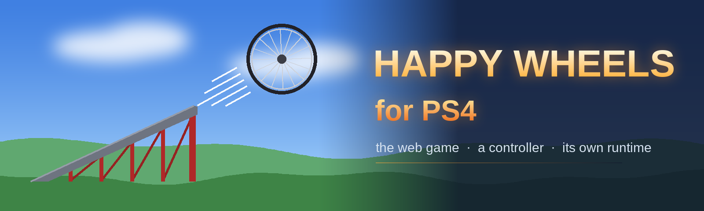

<p align="center">
  
</p>

<p align="center">
  <a href="https://github.com/iHaiDeeZ/HappyWheels-PS4/releases/latest"></a>
  
  
  <a href="LICENSE"></a>
</p>

<h3 align="center">Happy Wheels on your PS4, played with a controller.</h3>

<p align="center">
  <a href="https://github.com/iHaiDeeZ/HappyWheels-PS4/releases/latest"><b>⬇ Get the latest release</b></a> ·
  <a href="#getting-started">Getting started</a> ·
  <a href="#controls">Controls</a> ·
  <a href="#the-quick-menu">Quick menu</a> ·
  <a href="#faq">FAQ</a> ·
  <a href="#thanks">Thanks</a>
</p>

---

## Overview

Happy Wheels for PS4 is a standalone app for jailbroken PS4 consoles that plays
[Happy Wheels](https://totaljerkface.com/happy_wheels.tjf), the HTML5 game by Fancy Force, the way
its website runs it. It is no browser: it is a small runtime of its own, **h5**, made for this game
(JavaScriptCore for the game's code, its own browser layer in JavaScript, WebGL on the PS4's GPU,
Web Audio, the network), so the game gets the whole console.

The first time it starts, the app downloads the game from totaljerkface.com, the same files the
website's own page loads, and keeps them on the console. Each later start only asks the site whether
there's a newer version and takes it when there is, so new versions of the game arrive by
themselves. Without a connection it plays the copy it has.

The website's version of the game reads only the keyboard, so the app brings the controller: the
pad drives like the Steam version's controller layout, and a D-pad selector and a pointer handle
every menu, the level browser and the editor.

Nothing copyrighted is in this repository or the package: the game comes from its own website.

## Highlights

**The game as the website runs it**
- All of it: the featured levels, the user level browser, replays, the level editor and the
  characters, straight from totaljerkface.com.
- New versions of the game come in on their own at the next start; older files are cleaned up.
- Plays offline from the copy on the console once it has been downloaded.

**A controller, everywhere**
- Driving uses the Steam version's controller layout: **R2** to go, **L2** to go back, the
  **D-pad** or **left stick** to lean, **Cross**, **L1** and **R1** for the actions, **Circle** to
  eject.
- In menus, the **D-pad** moves a selection frame from option to option, the way a console game's
  menus work, and **Cross** clicks. Menus and dialogs open with an option already chosen. Up and
  down scroll long lists like the level browser.
- A pointer for everything else: the **touch pad** or the **left stick** moves it, **Cross**
  clicks, the **right stick** scrolls. The level editor is made for a mouse, and this is your mouse.
- **OPTIONS** opens the game's own menu while you play.

**A quick menu of its own**
- Hold the touch pad: a frame counter, the pointer's size and speed, the selector on or off, the
  controls, restart or quit.

**Built for the PS4**
- JavaScriptCore with its JIT, the game's WebGL drawn by Mesa on the PS4's GPU at 1080p, sound
  mixed on its own thread.
- The PS4 keyboard for every text field (level search, level names, your login).

## Getting started

**You need:** a jailbroken PS4 with **GoldHEN** (developed on a PS4 Pro), and an internet
connection the first time the app starts.

1. Grab the latest **`HappyWheels-vXX.XX.pkg`** from the
   [releases page](https://github.com/iHaiDeeZ/HappyWheels-PS4/releases/latest) and install it with
   GoldHEN's **Package Installer**.
2. Start **Happy Wheels**. The first start downloads the game and shows how far it has got: the
   title screen, the featured levels and a first level take about 16 MB, and levels and characters
   bring in more as you meet them.
3. Play. Hold the touch pad any time for the quick menu.

> **Tip:** the game runs at 30 frames a second by default, as on the website. Its own **Options**
> menu has a 60 FPS setting (it warns that it's heavier).

**Updating:** install the newer package on top of the old one. The game itself updates on its own,
and your progress and options stay in `/data/HappyWheels/`.

## Controls

### While you drive

| Press | To |
|---|---|
| R2 (or D-pad up) | Go |
| L2 (or D-pad down) | Go back / brake |
| D-pad left / right, left stick | Lean back / forward |
| Cross | The character's main action |
| L1 / R1 | Its two other actions |
| Circle | Eject |
| Touch pad (tap) | Switch the camera |
| OPTIONS | The game's menu (pause) |

They show on screen the first time you drive, and again from the quick menu's **Show the controls**.

### In menus, the level browser and the editor

| Press | To |
|---|---|
| D-pad | Move the selection (hold to keep going; at the end of a list it scrolls) |
| Cross | Click what's selected, or where the pointer is |
| Touch pad (slide) / left stick | Move the pointer |
| Right stick | Scroll, with the pointer out |
| OPTIONS | The game's menu, during a level |
| Touch pad (hold) | The quick menu |

The selection and the pointer take turns: moving the pointer hides the selection, and the D-pad
brings it back.

## The quick menu

Hold the touch pad for half a second. The game waits while the menu is open. **Up / Down** move,
**Left / Right** change a value, **Cross** picks, **Circle** or **OPTIONS** close it.

| Row | What it does |
|---|---|
| Resume | Back to the game |
| Frame counter | Frames the game draws each second and the milliseconds each one costs, in the corner |
| Pointer size | Small, Medium or Large |
| Pointer speed | Slow, Normal or Fast |
| D-pad selector | Turn the selection frame off if you'd rather use only the pointer |
| Show the controls | The driving controls, on screen for a few seconds |
| Restart game | Starts the game again (asks first) |
| Quit game | Back to the PS4's home screen (asks first) |

The menu also shows the app's version.

## Your files

Everything the app keeps is in **`/data/HappyWheels/`**:

- `web/`: the game as downloaded from the site (`version.json`, `js/`, `assets-…/`)
- `localStorage.json`: the game's options and your progress
- `cookies.txt`: the site's cookies (your login, if you log in)
- `runtime-settings.json`: the quick menu's settings
- `cache/mesa/`: the GPU's compiled shaders
- `h5.log`: the log, for bug reports

Deleting `web/` makes the next start download the game again.

## FAQ

**Does it need the internet?**
The first time, to download the game. After that it starts without a connection from the copy it
keeps; the level browser, featured levels, replays and logging in come from the site, so those
need a connection.

**Is this the Steam version?**
No, it's the version totaljerkface.com runs, which is often a little newer. It has the levels,
characters, editor and replays; the Steam version's extras (achievements, Steam friends, a list of
downloaded levels) aren't part of it. If you'd like to support the developers, the
[Steam version](https://store.steampowered.com/app/4705510/Happy_Wheels/) is the way.

**Why does the selection frame sometimes pick an option by itself?**
When a screen or a dialog opens, one of its options is chosen for you, as console games do. Move it
with the D-pad, or use the pointer.

**Something looks wrong or the app closes.**
[Open an issue](https://github.com/iHaiDeeZ/HappyWheels-PS4/issues) with what you were doing, your
console and firmware, and `/data/HappyWheels/h5.log`.

## Good to know

- Logging in opens the PS4 keyboard as soon as the login box appears: the game puts the cursor in
  its name field by itself.
- The title screen's Steam, App Store and Google Play badges lead out of the game; on a PS4 they do
  nothing, and the selection passes over them.
- Developed and tested on a PS4 Pro with GoldHEN.

## Building

The app is built in WSL (Ubuntu) with [ps4-kit](https://github.com/iHaiDeeZ/ps4-kit) (the OpenOrbis
toolchain) and the build tree of [OrbisWeb](https://github.com/iHaiDeeZ/OrbisWeb), whose JavaScriptCore
(with its JIT), Skia and Mesa (with the `ps4gl` front end) it reuses.

```sh
bash scripts/build-host-deps.sh vorbis   # the Vorbis decoder's sources
bash scripts/pack-jsc.sh          # JavaScriptCore's objects from OrbisWeb's WebKit build
bash scripts/build-mesa.sh        # Mesa: Zink on RADV, the ps4gl front end
HW_VERSION=00.07 bash scripts/build-ps4.sh    # -> out/HappyWheels-v00.07.pkg
```

A PC build of the same runtime runs the game headless for tests (`scripts/build-host-deps.sh`,
`scripts/build-host.sh`, `scripts/run-host.sh`), with `scripts/net-mock.py` standing in for the site.
`HW_EDITION=steam` builds an edition from your own Steam copy instead, with the Steam build's own
controller support. How it all fits together is in [`docs/DESIGN.md`](docs/DESIGN.md).

## Thanks

- **[Fancy Force](https://totaljerkface.com)**: Happy Wheels, by Jim Bonacci and team.
- **[WebKit](https://webkit.org)**: JavaScriptCore, the engine that runs the game's code.
- **[Skia](https://skia.org)**, **[Mesa](https://mesa3d.org)**, **[curl](https://curl.se)** and
  **[OpenSSL](https://www.openssl.org)**: 2D drawing, the GPU driver and the network.
- **[OpenOrbis](https://github.com/OpenOrbis)** and **[GoldHEN](https://github.com/GoldHEN/GoldHEN)**:
  the toolchain and the homebrew enabler that make PS4 apps possible.
- **[stb](https://github.com/nothings/stb)**, **[Liberation fonts](https://github.com/liberationfonts)**
  and **[Noto](https://fonts.google.com/noto)**: image decoding and the fonts the game asks for.

## License and disclaimer

The code in this repository is under the [MIT license](LICENSE). It includes the Liberation Sans and
Noto Sans fonts (SIL Open Font License, `runtime/fonts`), Mozilla's certificate list (MPL-2.0, as
Debian ships it), stb (public domain) and curl's and JavaScriptCore's API headers under their own
licenses.

This project has no ties to Fancy Force or Total Jerkface. Happy Wheels and its names are their
trademarks. The game is not in this repository or in the package: the app downloads it from
totaljerkface.com, as the website's own page does. Play it there, or buy it on Steam, to support
the people who made it.
